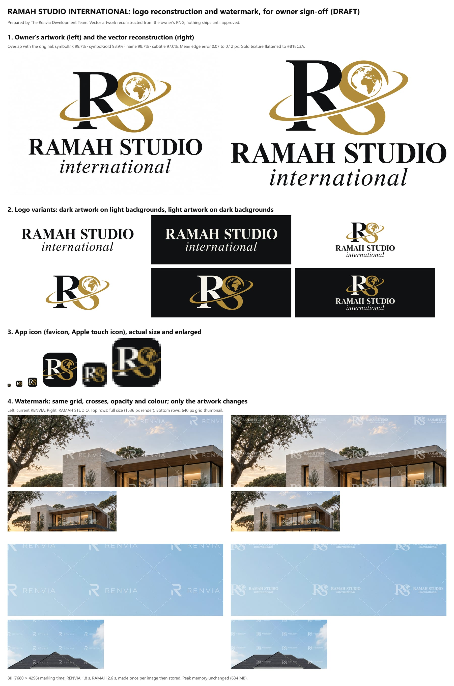

# Brand system: RAMAH STUDIO INTERNATIONAL

How the product's identity is defined, where it lives in the code, and how to change it. For the history of the move from the development name Renvia, see [rebrand-ramah-studio.md](rebrand-ramah-studio.md). For the watermark's layout and versions, see [watermark-design.md](watermark-design.md).



## Names

| Name | Use it for | Source |
| --- | --- | --- |
| **RAMAH STUDIO INTERNATIONAL** | The legal and official name | `brand.legalName` |
| **Ramah Studio International** | The copyright line, formal metadata (page title, Open Graph site name, manifest name), the logo's accessible name | `brand.name` |
| **Ramah Studio** | Everyday product copy: "Welcome back to Ramah Studio", "the Ramah Studio team", page title of the Studio, short manifest name | `brand.shortName` |
| **Ramah Studio Admin** | The operator console's title and headings | |
| RAMAH STUDIO / *international* | The wordmark artwork only (capitals over a smaller italic). Not written out as text | `brand.displayName`, `brand.subtitle` |

The word "Studio" on its own still names the product area (the canvas workspace) and the paid "Studio" plan. Those are not brand mentions; leave them.

Download and export filenames start with `ramah-studio-` (for example `ramah-studio-front-elevation-4k-2026-10-20.png`, `ramah-studio-audit-<id>.csv`).

## Logo

### Variants

| Variant | What it is | Where it is used |
| --- | --- | --- |
| `wordmark` (primary) | RAMAH STUDIO over a smaller italic *international* | Marketing navbar and footer, Studio and admin sign-in, dashboard sidebar, admin sidebar and header, loaders, help pages |
| `official` | The RS symbol above the wordmark | Formal or roomy placements (not used in the apps yet) |
| `symbol` | The RS symbol: R, S, globe and orbit | The Studio dashboard sidebar when it collapses to 76 px |
| App icon | The R and S on a charcoal tile, orbit running out of the frame | Favicons, Apple touch icon, install icons, the marketing navbar badge |
| Watermark unit | A single-colour, slightly bolder cut of the symbol and wordmark | Free-plan renders (API only) |

### In the apps

Each app has a thin `Logo` component in `components/brand/Logo.tsx` (`src/components/brand/Logo.tsx` in Studio and admin). All three are identical and draw from `@renvia/brand`:

```tsx
<Logo />                                         // wordmark, sized from the surrounding font size
<Logo wordmarkClassName="text-[20px] text-white" /> // 20px font size, white (for dark surfaces)
<Logo variant="symbol" />
<Logo variant="official" />
```

- **Size** comes from the font size: the wordmark is 1.6em tall (its capitals about 0.73em), the symbol 1.2em, the official logo 4.6em.
- **Colour:** the charcoal parts use the text colour (`currentColor`), so `text-primary` gives charcoal and `text-white` gives the light version on dark backgrounds. Gold stays gold.
- **Accessible name** is "Ramah Studio International" (`role="img"`, `aria-label`).

Why three copies of a small component rather than one shared React component: a component inside the brand package would load the package's own copy of React, which conflicts with marketing's React 19 (the Studio and admin use React 18). The artwork, the hard part, is shared; only the few lines of JSX are repeated.

### Standalone files

`packages/brand/assets/` holds files for use outside the apps (documents, slides, social posts):

| File | Contents |
| --- | --- |
| `logo-primary.svg`, `logo-primary-dark.svg` | Wordmark, charcoal, for light backgrounds |
| `logo-primary-light.svg` | Wordmark, ivory, for dark backgrounds |
| `logo-official.svg`, `logo-official-light.svg` | Symbol above wordmark, for light / dark backgrounds |
| `logo-symbol.svg`, `logo-symbol-dark.svg`, `logo-symbol-light.svg` | Symbol, for light / light / dark backgrounds |
| `logo-watermark.svg` | One watermark unit, white on transparent, 191 × 49 |
| `favicon.svg` | App icon with 22% rounded corners |
| `apple-touch-icon.png` (180), `icon-192.png`, `icon-512.png` | App icon, square (platforms round it themselves) |

Naming rule: **`-dark` is dark artwork for light backgrounds; `-light` is light artwork for dark backgrounds.** The unsuffixed file is the dark one.

Each app serves its own copy of the icons (`apps/*/public/favicon.svg`, `apps/*/public/apple-touch-icon.png`, `apps/marketing/app/icon.svg`, `apps/marketing/app/apple-icon.png`, `apps/marketing/public/icon-192.png` and `icon-512.png`). A brand test fails if any copy differs from `packages/brand/assets/`.

## Colours

| Token | Value | Use |
| --- | --- | --- |
| `brandColors.charcoal` | `#101113` | The logo's dark parts |
| `brandColors.gold` | `#B18C3A` | The logo's S, globe and orbit |
| `brandColors.ivory` | `#F5F2EA` | The logo's dark parts on dark backgrounds |

Charcoal and gold were sampled from the owner's artwork; the gold is the average of its metallic finish, flattened to one colour. They belong to the logo and formal identity. **The interface keeps its own palette**: blueprint blue `#2F6FED` remains the accent, and the Studio, admin and marketing Tailwind themes are unchanged.

## Typography

The logo's letterforms are part of the artwork, not a font: no typeface needs to be installed or licensed to show the logo. The interface fonts are unchanged: General Sans and Switzer in the Studio and on the website, Inter and Plus Jakarta Sans in the admin.

## Where the artwork comes from

The owner supplied the logo only as a flattened 1536 × 1024 PNG with no vector file. Its typefaces could not be matched: about 150 open-licence serif font files (several weights of each family) were compared letter by letter against the image, and the closest (Playfair Display Bold for RAMAH STUDIO, Libertinus Serif Italic for *international*) overlapped only 81% and 71%, with visibly different A crossbars, R legs and serifs.

So the logo is **reconstructed from the image** by `packages/brand/scripts/vectorize.mjs`: sub-pixel contours of the anti-aliased edges, corners kept sharp, curves fitted within 0.35 px. It measures how closely the result matches and records it in `src/logoPaths.js`:

| Part | Overlap with the original | Mean edge error |
| --- | --- | --- |
| R (black) | 99.7% | 0.07 px |
| S, globe and orbit (gold) | 98.9% | 0.12 px |
| RAMAH STUDIO | 98.7% | 0.10 px |
| *international* | 97.0% | 0.12 px |

This is a faithful reconstruction, not the original vector file. The globe keeps the artwork's own coastlines at every size, including the favicon. The owner's reference image is kept at `packages/brand/source/ramah-studio-international-logo.png`.

**If a designer later supplies vector originals**, replace the path data in `packages/brand/src/logoPaths.js` (same coordinate system or adjust the view boxes), run the asset export, and every app picks them up with no component changes.

## The brand package

`packages/brand` (`@renvia/brand`) is the single source of truth. It is plain JavaScript with hand-written type declarations and **no build step**, so the API on Vercel's Node runtime, the Vite apps and Next.js all import it as-is, with no build-order dependency between Vercel projects.

| Path | What it holds |
| --- | --- |
| `src/index.js` | `brand` names, `brandColors`, `logoArt` (the variants as view box + layers), `logoSvg()`, `iconSvg()` |
| `src/logoPaths.js` | Generated logo path data and its measured fidelity |
| `src/watermark.js` (`@renvia/brand/watermark`) | Watermark artwork: `watermarkMark` (current), `ramahWatermarkMark`, `renviaWatermarkMark` (kept for reference) |
| `src/watermarkPaths.js` | Generated watermark cut |
| `scripts/vectorize.mjs`, `scripts/trace.mjs` | Rebuild the path data from the reference image |
| `scripts/export-assets.mjs`, `scripts/appCopies.mjs` | Write `assets/` and copy the icons into each app |
| `src/index.test.mjs` | Names, colours, variants, fidelity floor, icons, watermark rules, asset and app-copy sync |

The watermark artwork has its own entry point so the apps never bundle it (it is about 24 KB); the package is marked `sideEffects: false`.

### Common changes

```bash
pnpm --filter @renvia/brand vectorize        # rebuild logo and watermark paths from source/
pnpm --filter @renvia/brand export-assets    # rewrite assets/ and every app's icons
pnpm --filter @renvia/brand test             # check names, artwork, and that app copies are in sync
```

- **Change a name:** edit `brand` in `src/index.js` (and its `.d.ts`); product copy in the apps is plain text, so search for the old wording too.
- **Change the logo:** update `logoPaths.js` (via `vectorize` or a designer's paths), then `export-assets`.
- **Change the watermark artwork:** see [watermark-design.md](watermark-design.md); it also needs a `WATERMARK_VERSION` bump.

## Watermark

Free-plan renders carry a repeating watermark: the RS symbol and two-line wordmark in white at 45% opacity, on the same level grid of tiles and dashed crosses the product has always used. Only the artwork in each tile changed with the rebrand (watermark version 3). Details, measurements, the version history, caching after a change and cleaning up old copies are in [watermark-design.md](watermark-design.md).

## What still says "renvia", on purpose

These are internal identifiers, invisible to customers. Renaming them would only add risk:

| Identifier | Why it stays |
| --- | --- |
| `@renvia/*` package names, root `package.json` name | Internal module names in hundreds of imports, the lockfile and build commands |
| API address `renvia-api.vercel.app`, Vercel project `renvia-api` | Every stored image URL contains this address; the API only serves URLs with its own address, so changing it breaks every image |
| R2 bucket `renviadb`, storage keys (`renders/`, `watermarked-v3/`, `thumbs/`) | Stored objects and database rows reference them |
| Browser storage keys (`renvia.studio.favorites`, `renvia:…`) | Renaming would silently wipe users' favourites, preferences and dismissed notices |
| `RENVIA_API_URL`, `RENVIA_CRON_SECRET` GitHub secrets | Repository secrets used by the operations workflow |
| Database migrations, test database `renvia_test`, test emails `@renvia.test` | History and test fixtures |
| Internal payment-settlement error messages ("No Renvia PayPal checkout matches…") | Staff-only diagnostics, also stored in historical rows |
| Image file paths such as `/hero/renvia-villa-premium.png` | File names only; the pictures carry no branding |
